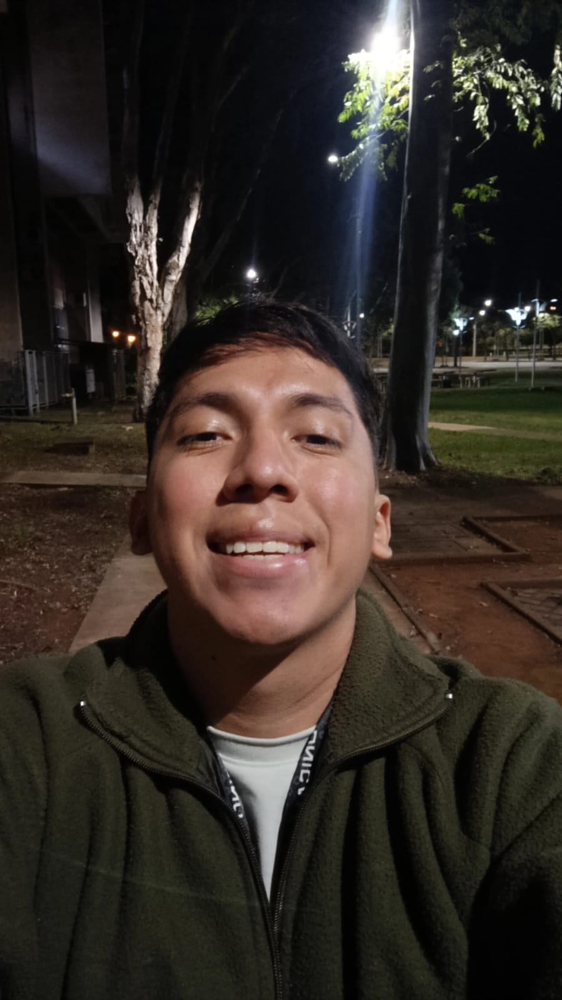

::: {.profile-hero}

::: {.profile-copy}

## About me

::: {.profile-intro}
I'm Pablo, from Ecuador, and I now live in Campinas, Brazil. I came to mathematics through statistics, and my studies have gradually drawn me toward probability theory and more abstract mathematical questions. I'm currently pursuing a Master's in Statistics at the [University of Campinas (UNICAMP)](https://www.unicamp.br/).

What I enjoy most about research is following a question far enough to understand the ideas behind it. These days, that often means thinking about randomness, memory, and the structures that govern a stochastic process.

I also care about communicating science: explaining why a question is worth asking, what research helps us understand, and how fundamental research can contribute to technology and society. I enjoy football and music, too.
:::

:::

::: {.profile-photo}

:::

:::

## Research

My main research interests lie in **probability theory**, particularly the compatibility and uniqueness of probability laws, stochastic systems with infinite memory, and ergodic phenomena in measurable dynamical systems. Further interests include stochastic differential equations and interactions between probability and statistics.

Current research uses absolute continuity, Hellinger-type quantities, conditional probability kernels, disintegration, and ergodic arguments to study probability laws associated with chains with complete connections and related shift systems.

[Research & experience →](research.html)

## Education

- **Master's in Statistics — in progress.** University of Campinas (UNICAMP), Campinas, Brazil.
- **BSc in Statistics — 2025.** Escuela Superior Politécnica del Litoral (ESPOL), Guayaquil, Ecuador.

## Academic activities

### Poster presentation

[**Hellinger Criteria for Uniqueness and Dynamic Uniqueness in Infinite-Memory Shift Systems**](posts/workshop-fortaleza/index.html)  
**3rd Workshop on Combinatorics, Number Theory and Dynamical Systems**  
Labomar, Universidade Federal do Ceará (UFC) — Fortaleza, Brazil  
19–23 October 2026 · Accepted poster; upcoming presentation.

### Academic recognition

[**Cuartiles Mayores — seventh edition**](posts/cuartiles-mayores/index.html)  
Escuela Superior Politécnica del Litoral (ESPOL), Ecuador  
Selected as a student honoree; ceremony scheduled for 16 November 2026.

[All academic activities →](posts.html) · [Teaching](teaching.html)

## Get in touch

You can reach me by [email](mailto:p218730@dac.unicamp.br), or find me on [GitHub](https://github.com/pabzun) and [LinkedIn](https://www.linkedin.com/in/pablo-zúñiga-b57426215).
