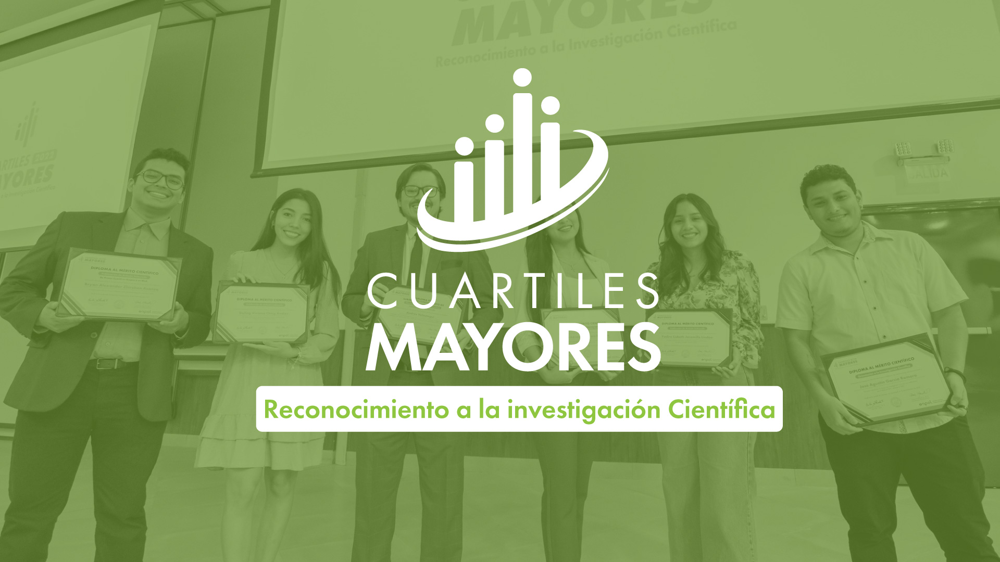

::: {.event-intro}

::: {.event-facts}
**Recognition:** selected among the student honorees for the seventh edition of Cuartiles Mayores.  
**Institution:** Escuela Superior Politécnica del Litoral (ESPOL), Ecuador.  
**Ceremony:** 16 November 2026, 10:00.  
**Venue:** STEM building, Campus Gustavo Galindo Velasco, Ecuador.
:::

::: {.event-visual}

{.event-image}

::: {.event-image-credit}
Official Cuartiles Mayores banner · [ESPOL](https://www.espol.edu.ec/es/cuartiles-mayores).
:::

:::

:::
