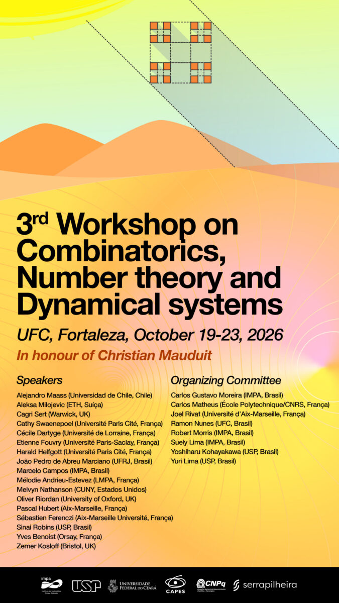

::: {.event-intro}

::: {.event-facts}
**Presentation:** poster presented at the workshop.  
**Event:** 3rd Workshop on Combinatorics, Number Theory and Dynamical Systems.  
**Venue:** Saint Martin Fortaleza – Auditório Platão.  
**Location:** Fortaleza, Brazil.  
**Dates:** 19–23 October 2026.  
**Support:** financial support from the workshop organizers, IMECC (UNICAMP), and CAPES.
:::

::: {.event-visual}

{.event-image}

::: {.event-image-credit}
Official workshop poster · [IMPA](https://impa.br/evento/3rd-workshop-on-combinatorics-number-theory-and-dynamical-systems-2/?lang=en).
:::

:::

:::

## Research topic

Compatibility and uniqueness of probability laws in systems with infinite memory, including chains with complete connections and related shift systems.

[Current research](../../research.html#current-research)
